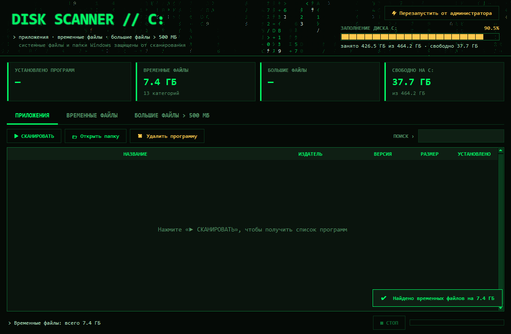

[README.md](https://github.com/user-attachments/files/33397219/README.md)
# Disk Scanner C:

Сканер диска C: для Windows в стиле «зелёный терминал». Находит установленные программы, временные файлы и файлы больше 500 МБ и помогает освободить место, не затрагивая системные файлы.



## Возможности

**Приложения**
- Список установленных программ из реестра: название, издатель, версия, размер, дата установки. Есть поиск и сортировка по столбцам.
- Удаление программы через её стандартный деинсталлятор.
- **Полное удаление** без деинсталлятора, командами cmd:
  - `taskkill` — завершает процессы программы;
  - `sc stop` / `sc delete` — останавливает и удаляет её службы;
  - `rd /s /q` — удаляет папку программы и остатки в AppData и ProgramData;
  - `del` — удаляет ярлыки;
  - `reg delete` — удаляет ключи реестра, включая регистрацию Windows Installer.

  Перед удалением показывается полный список того, что будет удалено, а после — журнал выполненных команд.

**Временные файлы**
- `%TEMP%`, `Windows\Temp`, кэш WinINet, дампы падений, кэш эскизов проводника.
- Кэши браузеров: Chrome, Edge, Яндекс.Браузер, Opera, Firefox.
- Файлы моложе 1 часа и занятые другими программами не удаляются.

**Большие файлы (> 500 МБ)**
- Поиск по всему диску C:.
- Можно показать файл в проводнике или переместить его в корзину.

## Безопасность

- Не сканируются: папка Windows, корзина, `System Volume Information`, точки восстановления, файлы подкачки и гибернации, а также файлы с атрибутом «системный».
- Program Files и ProgramData при поиске больших файлов по умолчанию пропускаются.
- Полное удаление не трогает:
  - системные и общие папки (Windows, корень Program Files, AppData, `Common Files`, `Plug-ins`, `Package Cache` и т.п.);
  - папки, в которых установлены другие программы;
  - папки, имя которых не похоже на название программы.
- Перед любым удалением приложение спрашивает подтверждение.

> ⚠️ Полное удаление и очистка временных файлов необратимы. Пользуйтесь ими осознанно.

## Структура проекта

```
├── app/                    готовое приложение
│   ├── DiskScanner-x64.exe   64-битная Windows (большинство компьютеров)
│   ├── DiskScanner-x86.exe   32-битная Windows
│   └── DiskScanner-arm64.exe Windows на ARM (Snapdragon и др.)
├── src/                    исходный код
│   ├── disk_scanner.py     всё приложение (tkinter, winreg, ctypes)
│   ├── make_icon.py        генерация иконки
│   ├── icon.ico            иконка
│   ├── build.bat           сборка exe в папку app/ (архитектура = архитектура Python)
│   ├── run.bat             запуск из исходников
│   └── run_as_admin.bat    запуск из исходников от имени администратора
├── .github/workflows/build.yml   автосборка x64 / x86 / ARM64 на GitHub
├── docs/screenshot.png
├── LICENSE
└── README.md
```

## Запуск

**Готовое приложение.** Скачайте файл для своей системы и запустите его. Python не нужен.

| Система | Файл |
|---|---|
| Windows 10/11, 64-бит (Intel/AMD) — почти все компьютеры | [`app/DiskScanner-x64.exe`](app/DiskScanner-x64.exe) |
| Windows, 32-бит | [`app/DiskScanner-x86.exe`](app/DiskScanner-x86.exe) |
| Windows 11 на ARM (Snapdragon и др.) | [`app/DiskScanner-arm64.exe`](app/DiskScanner-arm64.exe) |

Узнать разрядность можно в «Параметры → Система → О программе → Тип системы». Чтобы программа видела все папки, нажмите в ней «Перезапустить от администратора».

> Приложение работает только в Windows: оно использует реестр, системные функции Windows и команды `cmd`. Версий для macOS и Linux нет.

**Из исходников** (Windows, Python 3.10+). Сторонние библиотеки не нужны:

```bat
python src\disk_scanner.py
```

Или запустите `src\run.bat` (`src\run_as_admin.bat` — от имени администратора).

## Сборка exe

```bat
pip install pyinstaller pillow
src\build.bat
```

Готовый файл появится в `app\DiskScanner-<архитектура>.exe`. Архитектура совпадает с архитектурой Python, которым идёт сборка. Чтобы собрать другую, передайте путь к нужному Python:

```bat
src\build.bat C:\Python310-32\python.exe
```

PyInstaller не умеет собирать для другой архитектуры. Поэтому ARM64-версию можно собрать только на ARM-компьютере или в GitHub Actions.

**Автосборка на GitHub.** Workflow [`.github/workflows/build.yml`](.github/workflows/build.yml) собирает x64, x86 и ARM64. Его можно запустить вручную на вкладке Actions → Build → Run workflow — готовые exe появятся в артефактах. Если отправить тег, например `git tag v1.0.0 && git push --tags`, все три exe автоматически прикрепятся к новому Release.

Иконку `icon.ico` создаёт скрипт `make_icon.py`.

Exe не подписан цифровой подписью, поэтому Windows SmartScreen может показать предупреждение: нажмите «Подробнее» → «Выполнить в любом случае».

## Лицензия

[MIT](LICENSE)
